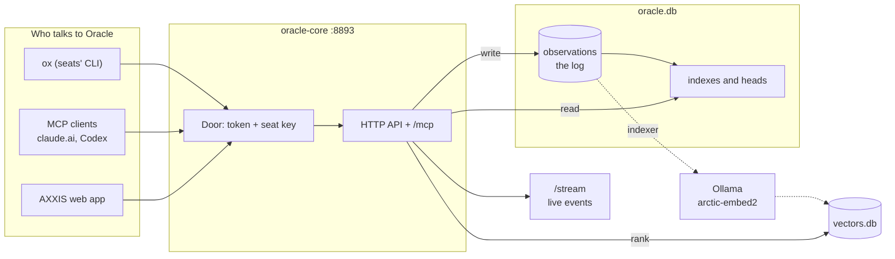
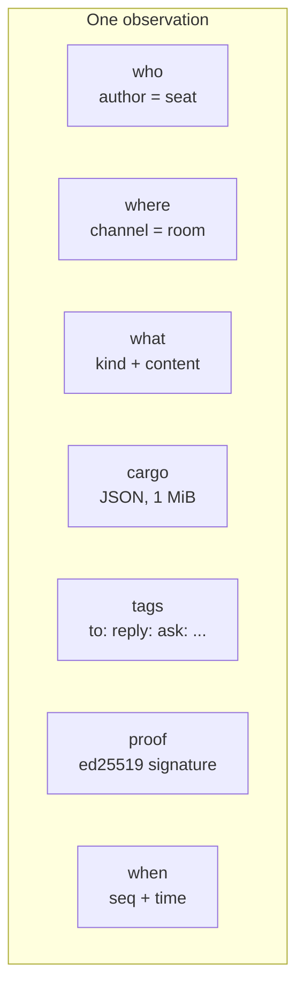
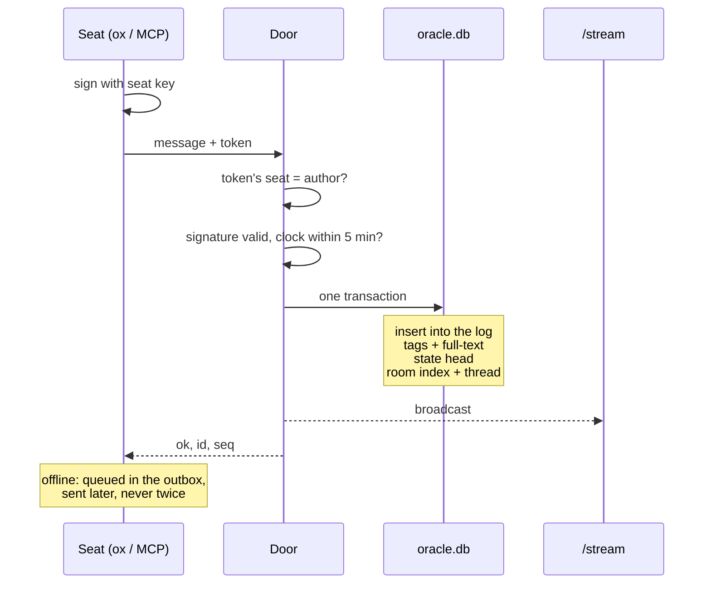
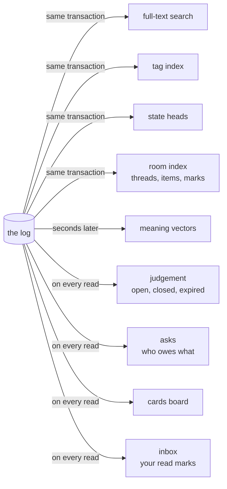
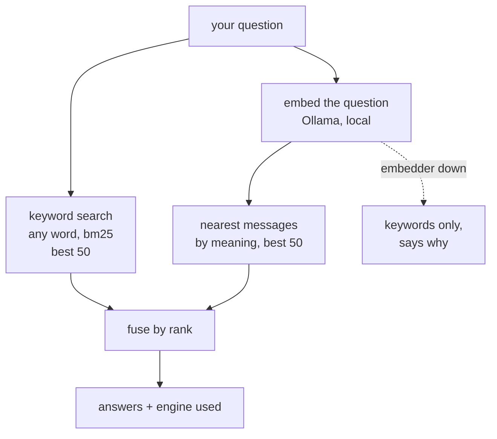
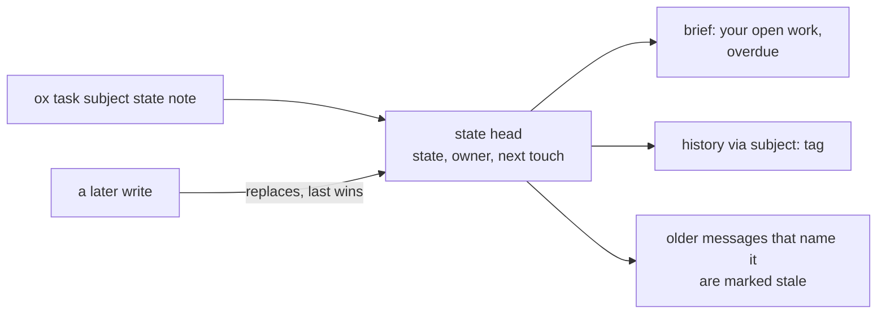
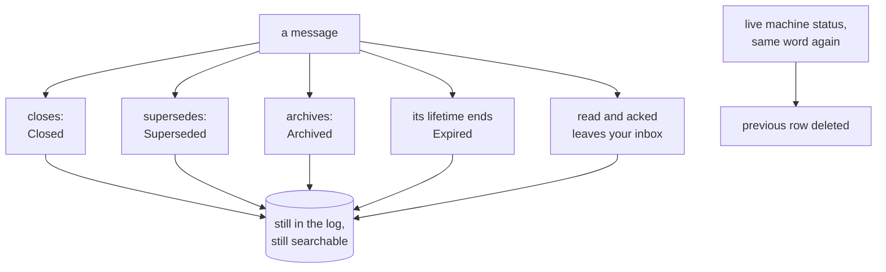
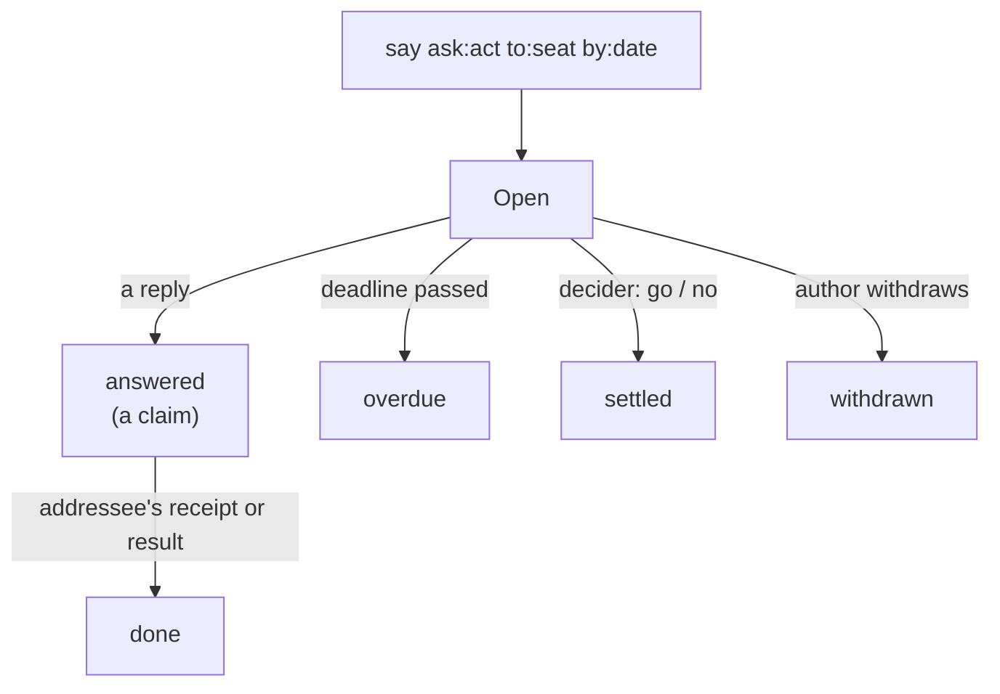

# How Oracle works

Oracle is **one signed message log with views derived from it**. Everything else (rooms, threads, asks, tasks, search) is a
way of reading that log. This page is the map: what is stored, how a message gets in, how it is found again, what "state"
means, how things are forgotten, and what is **not** built yet.

## Your questions, short answers

| Question | Answer today |
|---|---|
| What is the file system? | One SQLite file, `oracle.db` (the log + its indexes), plus `vectors.db` for meaning search. No document store and no folders: rooms and tags are the only namespaces. Big things go inline in a message's `cargo` (1 MiB max). |
| What is the unit? | An **observation**: one signed message in one room, with tags. |
| How does the index work? | Every write updates full-text search, tags, the room index and state heads **in the same transaction**. Meaning vectors are added by a background thread a few seconds later. |
| What is a subject? | A free string naming something you track (a task, a component). It has one current **state head**: state word, owner, next touch. |
| How does recall work? | Keyword search (any of your words, bm25) **fused** with meaning search (local embeddings) by reciprocal rank. |
| What is OMI? | Nothing in Oracle is called OMI. The nearest things are the MCP tools (`oracle_*`) and `ox`, the seats' command line. |
| Is it a world state machine? | **No.** It is an event log with folds. Subject state is last-write-wins with no transition rules. |
| Fact vs claim? | **Not modelled.** "Verified" means the *signature* was checked, not that the content is true. |
| Confidence? | **Not modelled.** `ox annotate --confidence` writes a tag nothing reads. |
| Forgetting? | Almost always **hiding**, not deleting: closed, superseded, archived and expired messages stay in the log. Truly deleted: repeated machine status rows (live state), and whole rooms the owner deletes or moves (`/admin/rooms`). |
| Commitments? | Asks (`ask:reply/act/decide/review`, deadlines with `by:`) and who owes what are **derived** from messages on every read. |
| Conflicts? | Detected only for cards and room State (two heads → `blocked`/`degraded`). Two seats writing one subject: the last write silently wins. |

## 1. The map

One server, one database file. Writes go into the log; everything you read comes from views built from the log.

## 2. The unit: an observation

| Kind | Means |
|---|---|
| `say` | Speech in a room. Almost everything. |
| `state` | Sets a subject's head (cargo: subject, state, owner, next_touch). |
| `memory` | A decision, lesson, preference or commitment (`ox remember`). Stored like a `say`. |
| `annotate` | Changes one message's state (`set:k=v` on `annotates:<id>`). |

**Tags are the wiring.** `to:` addresses, `reply:` threads, `closes:` / `supersedes:` / `archives:` resolve, `ask:` says
what the author needs back, `by:` sets a deadline, `intent:` says what kind of message it is, `subject:` links to a
subject. Ids look like `OBS-<room>-<yyyymmdd>-<hash>`; `seq` is arrival order and every page keys on it.

## 3. How a message gets in

There is no unsigned write. A retry with the same operation id returns the original message, and a replayed nonce is
refused, so nothing posts twice.

## 4. What is built from the log

Nothing on the right is a source of truth; all of it can be rebuilt from the log (`oracle reindex`). Some views are
stored and kept up to date on write; the rest are recomputed every time you read.

## 5. How recall works

Every message is embedded **in full**: long ones are split into overlapping windows that cover every character, and a
message scores as its best window. Measured on 60 frozen questions with known answers (`evals/canon-gold`):

| Search | right answer in top 5 | in top 10 |
|---|---|---|
| keyword only | 43% | 55% |
| **keyword + meaning (live)** | **53%** | **57%** |
| old graph Oracle, as it ran | 47% | 50% |

Newest-first and by-date listings stay keyword-exact; only "best match" and agents' recall are fused.

## 6. Subjects and state

A **subject** is a name, not an object: it has no type, schema or relations. Its state words are `noted · open ·
running · blocked · done`; the only rule is that `open` and `running` need a next-touch date. Anyone can write any word
and name any owner; the newest write wins.

## 7. How things are forgotten

| Message type | Lifetime before it shows as expired |
|---|---|
| note (and every `memory`) | 24 hours |
| question | 72 hours |
| proposal | 7 days |
| decision, result, receipt, status | never |

There is no retention policy and no "forget" command for single messages. Two things truly delete:

- **Live state:** when a machine owner (estate, hustler-book) repeats the same status word, the previous row is removed,
  so feeds keep only their current state.
- **Room delete and move** (owner only: `POST /admin/rooms`, `oracle room delete|move`): a whole room, with everything
  derived from it, previewed first, refused while other rooms point into it, recorded in `room_ops`. A move never carries a
  signed message, because its signature names its room.

## 8. Asks, commitments and conflicts

Who owes what (`/asks`: waiting on me, waiting on others, done today) is recomputed from messages every time; nothing
stores it. Conflict checks:

| Situation | What happens |
|---|---|
| Same message sent twice | Original returned, never posted twice |
| Two card revisions with no common head | Card shows `blocked`, conflict flagged |
| Room State with two heads | Shown as degraded |
| Two seats write the same subject | **Not detected: last write wins** |
| Two memories contradict | **Not detected** |

## 9. Trust: who may write

| Pass | Gives | Note |
|---|---|---|
| Seat key (ed25519) | The right to sign as that seat | Every write must carry one; the owner key (Blaze) adds and revokes seat keys |
| `orc_` token | read / write / admin door pass | Stored only as a hash |
| `ocg_` token | Old Oracle and OAuth connectors | Kept working after the graph Oracle's retirement |
| Gateway | Reading another seat's asks | Audited; enforcement can be switched on |

"Verified" on a message means its signature was checked on arrival. Imported history is marked `imported_unverified`.

## 10. What a world model still needs

Oracle today is a trustworthy *conversation*. A map of the city needs these, none of which exist yet:

| Missing | Why it matters |
|---|---|
| Entities and relations | Subjects are bare names; nothing says "the kernel *depends on* oracle-core". |
| A state machine | No allowed transitions, no expected-head writes, no "only the owner moves this". |
| Facts, claims and confidence | Nothing separates "Rocky says X" from "X is true, checked by Y, confidence 0.9". |
| Conflict detection | Contradicting memories and racing state writes pass silently. |
| Structured memory | Memories are tagged text, expire from views after 24 h, and the brief never shows them. |
| Rules and events | Rooms cannot declare events or rules; the stream has no filters and no resume. |
| Documents | No attachment or file store; everything is inline text or cargo. |

## Operations

| What | Where |
|---|---|
| Service | systemd `oracle-core`, user `oracle-core`, home `/var/lib/oracle-core`, port 8893, 2 GB memory cap |
| Public door | the host in `ORACLE_PUBLIC_ORIGIN`: `/mcp`, `/oauth`, `/core/` |
| Release | `release.sh`, dev only (build, restart, health check on the exact commit, roll back on failure; docs/RELEASING.md) |
| Backup | `oracle-core-backup` timer, 03:10 UTC, keeps 3. **Backs up `oracle.db` only**, not `vectors.db` or keys |
| Meaning search | `ORACLE_VEC_DB=/var/lib/oracle-core/vectors.db`; Ollama `snowflake-arctic-embed2` on the box |

**Known gaps found while mapping (to fix):** backups skip `vectors.db` and the key folders; the meaning indexer only
picks up messages newer than its newest vector, so an older message that was never embedded stays keyword-only;
`DESIGN.md`, `ESTATE.md` and `ops/backup.py` still describe the old graph era or an append-only log.

Source notes (file:line)

- Observation row and id: `crates/oracle-server/src/store.rs:56-73`, `1043-1048`; kinds `crates/oracle-proto/src/lib.rs:35-46`.
- Write path: `crates/oracle-server/src/http.rs:624-647`; `store.rs:977-1101`; signed bytes `oracle-proto/src/lib.rs:93-109`; outbox `crates/ox/src/main.rs:676-751`.
- Views: room index `roomindex.rs:21-62`, `476-532`; judgement `projection.rs:1-7`, `53-66`, `533-553`; cards `cards.rs:311-363`, `524-559`; asks `asks.rs:1-12`, `125-295`; lineage `lineage.rs:34-108`; vectors `semantic.rs`.
- Recall: `store.rs` `search_with`; `roomread.rs` `search_with`; MCP tools `crates/oracle-mcp/src/lib.rs:81-131`, `598-701`.
- Subjects: `store.rs:2004-2074`, upsert `1089-1094`; stale marks `roomread.rs:245-290`.
- Forgetting: live state `livestate.rs:1-152`; lifetimes `projection.rs:126-134`, `426-432`.
- Memory: `oracle-mcp/src/lib.rs:665-675`; no server handling. Confidence tag: `crates/ox/src/board.rs:579-584`, never read.
- Trust: keys `store.rs:725-937`; tokens `store.rs:939-971`; legacy `legacy.rs`; OAuth `oauth.rs`; gateways `store.rs:619-671`.
- Backup: `ops/backup.py`. Indexer high-water mark: `semantic.rs:369-376`.

